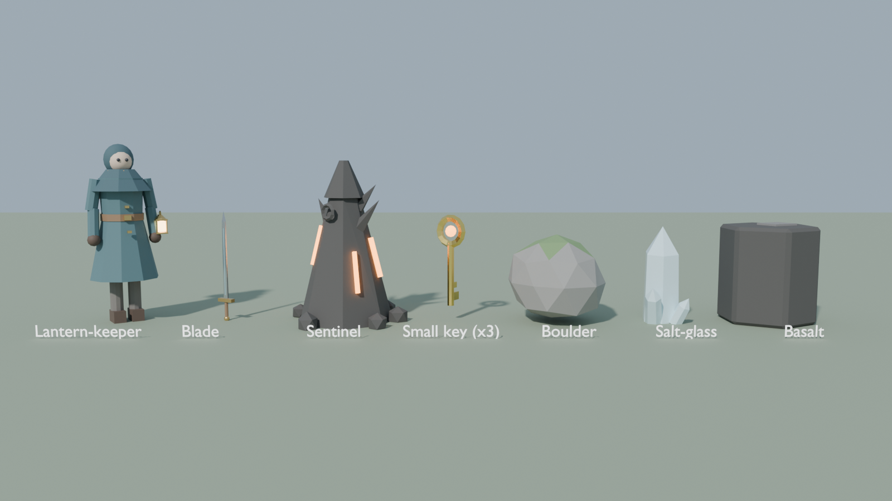
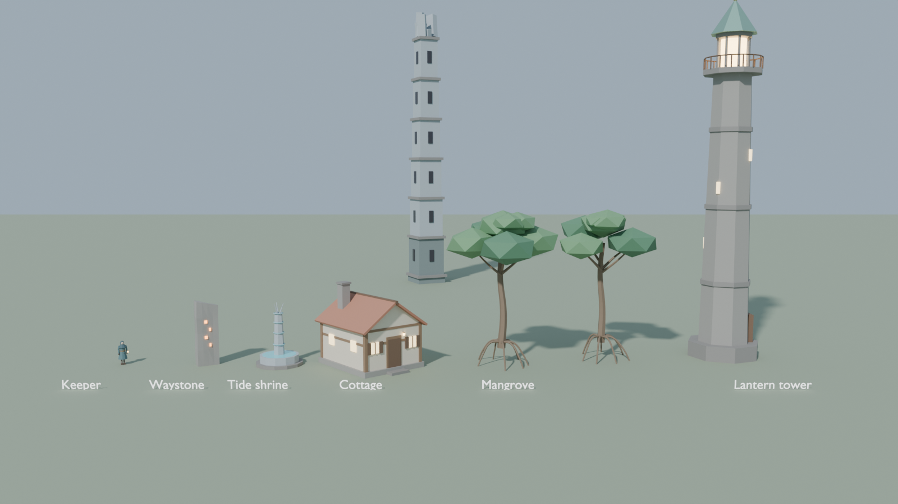

# Emberveil (working title)

An original third-person action-adventure prototype for **Unreal Engine 5.4+ (C++)**.
You play a lantern-keeper crossing a drowned archipelago, armed with a blade and the
**Tidehorn**, an instrument whose cadences wake old mechanisms.

## The archipelago

Press Play in an empty level and the game mode generates the island (about 3.2 km across)
around you:

```
                 Saltglass Dunes          Drowned Spires
                  (salt + glass)       (lagoon, low-tide only)
                         \                 |  <- tidal causeway
   Lanternhold  ------  The Shallows  ------  Mangrove Lattice
  (start village,      (hub plain,           (flooded forest)
   lantern tower)     Waystone Circle)
                               \
                            Cinder Rise
                       (volcano, lava crater)
```

- **Day/night:** a full day lasts 16 real minutes. The sun and moon move through a physical
  sky, and after dark sentinels rise on the Shallows, then crumble at dawn.
- **Tides:** water rises and falls twice a day (high at 00:00/12:00, low at 06:00/18:00). The
  causeway to the Drowned Spires and the lagoon floor are only walkable at low water. Wade in
  shallow water (slower); go deeper than chest height and the current drags you back to dry
  ground.
- **Tide shrines:** play the **Tidecall** beside one to hold the tide low for 2.5 minutes. One
  stands where the causeway leaves the Shallows, and one on the Spires island so you're never stranded.
- **The Sunken Vault:** the arch on the Drowned Spires island is a portal into the dungeon
  described below. A portal inside the entrance leads back.
- Region names fade in as you cross borders. The HUD shows the clock and tide.

Generation code: `World/OverworldBuilder` (terrain, regions, roads, landmarks),
`World/EnvironmentController` (time, sky, tide), `World/NightSpawner`, `World/TideShrine`,
`World/WarpPortal`.

Everything in this repo is greybox: engine basic shapes, a canvas HUD and input built in
code. No authored `.uasset` files are needed to play the first test dungeon.

## What's in the prototype

| System | Where | Notes |
| --- | --- | --- |
| Third-person controller + camera | `Player/EmberveilCharacter` | Spring-arm camera, jump, greybox body with a lantern light |
| Target lock-on | `Components/LockOnComponent` | Strafe around the target, cycle left/right, auto-retarget on kill, camera recenter when nothing is in view |
| 3-hit melee combo | `Components/MeleeComboComponent` | Input buffering, combo window, sphere-overlap hits (no animations needed) |
| Health / damage | `Components/HealthComponent` | Works with `UGameplayStatics::ApplyDamage`; i-frames |
| Small keys + relic | `Components/InventoryComponent` | |
| Tidehorn (5 notes) | `Components/MelodyComponent` | Matches the most recent notes against known cadences and notifies nearby `IMelodyReceiver` actors |
| Enemy | `World/EmberSentinel` | Chases, telegraphs attacks (eye turns red), hit-stun, optional key drop. No NavMesh required |
| Locked door / melody gate | `World/LockedDoor`, `World/MelodyGate` | Both derive from `SlidingBarrier` |
| Goal | `World/RelicPedestal` | Dormant until its cadence is played |
| Test dungeon | `World/TestDungeonBuilder` | 4 rooms built at runtime from basic shapes, with braziers and fallback lighting |
| HUD | `Core/EmberveilHUD` | Health, keys, notes played, lock-on reticle, messages, controls |

### Sunken Vault (dungeon) flow

1. **Start room:** move around and practise jumping on the ledges.
2. **Sentinel room:** defeat the two sentinels. One drops a **small key**.
3. **Locked door:** walk into it with the key.
4. **Gate room:** walk up to the blue gate to read its inscription, then play that cadence on the Tidehorn.
5. **Relic room:** read the pedestal, play its cadence, then claim the Ember Relic.

## Art kit

Original low-poly models, generated by a Blender script and exported as FBX:




| Asset | Used for | Pivot |
| --- | --- | --- |
| `SM_LanternKeeper`, `SM_Blade` | Player body and sword | feet / grip |
| `SM_Sentinel` | Enemy body (the eye is still a separate glowing sphere) | base |
| `SM_Key`, `SM_TideShrine` | Pickup, Tidecall shrine | centre / base |
| `SM_House`, `SM_LanternTower` | Lanternhold | base |
| `SM_StandingStone` | Waystone Circle | base |
| `SM_Spire` | Drowned Spires | base |
| `SM_Mangrove_A/B` | Mangrove Lattice | base |
| `SM_Boulder_A/B`, `SM_BasaltColumn`, `SM_GlassShard` | Shallows, Cinder Rise, Saltglass Dunes | centre (unit-sized) |

**Pipeline**

1. *(Optional)* Regenerate or tweak the models:
   `pip install bpy` (Blender as a Python module, Python 3.13), then
   `python Tools/Blender/generate_assets.py --out Art/Source/Meshes --preview-dir Art/Previews`.
   The same script also runs inside Blender: `blender -b -P Tools/Blender/generate_assets.py -- --out Art/Source/Meshes`.
2. Import into Unreal: open the project and run **Tools > Execute Python Script** on
   `Tools/Unreal/import_assets.py`. The meshes land in `/Game/Emberveil/Meshes`.
3. Press Play. The code picks up whichever meshes exist (`UEmberveilStatics::LoadArtMesh`) and
   keeps greybox shapes for anything missing, so the project runs before and after importing.

The models are static meshes with flat-colour materials. The character has no skeleton yet, so it
glides rather than walks. Rigging and animating it is the next art step.

## Controls

| Action | Keyboard / mouse | Gamepad |
| --- | --- | --- |
| Move / look | WASD / mouse | Left / right stick |
| Jump | Space | A (bottom face) |
| Attack (tap up to 3x) | Left mouse | X (left face) |
| Lock-on / recenter camera | Q or middle mouse | Right stick click |
| Cycle target | E / mouse wheel | Bumpers |
| Tidehorn notes 1-5 | 1 2 3 4 5 | D-pad up/right/down/left, Y |

## Getting it running (Windows)

1. Install **Unreal Engine 5.4 or newer** from the Epic Games Launcher, plus **Visual Studio 2022**
   with the *Game development with C++* workload.
2. Clone this repo. Right-click `Emberveil.uproject` and choose **Generate Visual Studio project files**.
   If you use a newer engine, choose it under *Switch Unreal Engine version* first.
3. Open `Emberveil.sln`, set the configuration to **Development Editor**, and build.
   Or just double-click `Emberveil.uproject` and accept the prompt to compile.
4. In the editor, choose **File > New Level > Empty Level** and press **Play**. The game mode
   generates the archipelago (expect a few seconds' hitch while terrain collision cooks) and
   drops you in Lanternhold. Use an *empty* level: the overworld brings its own sun, sky and fog.
5. Save that level and set it as **Project Settings > Maps & Modes > Editor/Game Default Map**.

> If the ground is invisible from above but you can stand on it, the triangle winding is
> backwards for your engine version: tick **bFlipTerrainWinding** on the overworld builder
> (or flip its default in `OverworldBuilder.h`).
>
> This code was written without access to an Unreal toolchain, so it hasn't been compiled yet.
> If the first build reports errors, they should be small API mismatches. Paste the build log
> into an issue or chat and fix them before adding features.

## Turning the prototype into a game

- **Art:** replace the greybox meshes in `AEmberveilCharacter` with a skeletal mesh and an
  Animation Blueprint, then drive swings from `UMeleeComboComponent::OnSwingStarted` with anim notifies.
- **Input:** input is built in `BuildInputMappings()` so it works without assets. Moving it to
  `IA_*` / `IMC_*` assets lets players rebind keys.
- **Terrain:** the procedural island is a starting point. Once the layout feels right, recreate
  it as a Landscape with real materials, foliage and water (Water plugin) for production quality.
- **Levels:** set `bAutoBuildOverworld` / `bAutoBuildTestDungeon = false` on the game mode (or a Blueprint subclass)
  and build real levels by hand. Doors, gates, keys, sentinels and pedestals are all placeable actors.
- **Cadences:** add entries to `UMelodyComponent::KnownCadences`. Any actor that implements
  `IMelodyReceiver` can react to them.
- **Audio:** each note is a good fit for a MetaSound with five pitch presets, triggered from `OnNotePlayed`.

## Project layout

```
Emberveil.uproject
Config/                     Engine, game and input settings
Source/Emberveil/
  Core/                     GameMode, HUD
  Player/                   Player character
  Components/               Health, lock-on, combo, inventory, melody
  World/                    Barriers, pickups, enemy, relic, test dungeon builder
```
